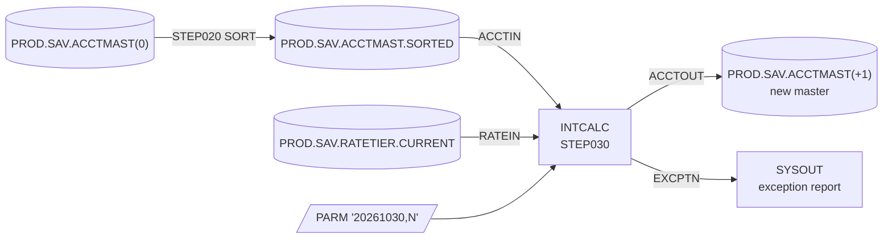

# Module 1: Legacy COBOL Docs
 
 
| Topic                                                            | Minutes |
|------------------------------------------------------------------|---------|
| Give the model the whole picture: program, copybooks and JCL     | 5       |
| Prompts that explain, extract and cite                           | 5       |
| Guided practice: explain INTCALC and extract its business rules  | 20      |
 
**Total lesson run time:** 30 min
 
## Table of Contents
 
- [Learning Objectives](#learning-objectives)
- [What You'll Need](#what-youll-need)
- [Introduction: an audit handoff due Friday](#introduction-an-audit-handoff-due-friday)
- [Give the model the whole picture: program, copybooks and JCL](#give-the-model-the-whole-picture-program-copybooks-and-jcl)
- [Prompts that explain, extract and cite](#prompts-that-explain-extract-and-cite)
- [Guided practice: explain INTCALC and extract its business rules](#guided-practice-explain-intcalc-and-extract-its-business-rules)
    - [Step 1, map the files (4 minutes)](#step-1-map-the-files-4-minutes)
    - [Step 2, map the flow (5 minutes)](#step-2-map-the-flow-5-minutes)
    - [Step 3, extract the business rules (7 minutes)](#step-3-extract-the-business-rules-7-minutes)
    - [Step 4, make the model prove it, then check impact (4 minutes)](#step-4-make-the-model-prove-it-then-check-impact-4-minutes)
- [Check for Understanding](#check-for-understanding)
- [Summary](#summary)
- [Vocabulary](#vocabulary)

## Learning Objectives
 
- Assemble the right context for an AI assistant (program, copybooks and JCL), and explain what the model gets wrong when any one of them is missing.
- Correlate JCL DD statements with `SELECT ... ASSIGN` clauses to identify every dataset a program reads and writes.
- Prompt Copilot Chat to explain a program's paragraphs and `PERFORM` structure, and decode 88-level condition names into plain-English business rules.
- Extract calculation logic into a business logic spec, including where values are truncated or rounded.
- Identify which other programs a change to a shared copybook could affect, and where the AI's view of that impact ends.
- Verify an AI explanation against the source code, and correct the claims it gets wrong before you share them.
## What You'll Need
 
Everything runs in VS Code. You won't compile or run anything in this lesson; you'll read code and prompt.
 
- VS Code with the course COBOL extension installed, so `.cbl`, `.cpy` and `.jcl` files open with syntax highlighting
- GitHub Copilot Chat, signed in and open in the side panel
- The `module-1/` folder from the course pack, open as your VS Code workspace: `INTCALC.cbl`, `ACCTREC.cpy`, `RATETIER.cpy` and `EODINT.jcl`
- A new, empty file in the same folder called `INTCALC-spec.md`, which you'll fill in during the guided practice and extend in the Lab
> [!IMPORTANT]
> Everything in the course pack is synthetic. The program, datasets and account numbers are invented for training. On your own code, never paste production data, real account numbers or customer details into a prompt. Mask them first, every time.
 
## Introduction: an audit handoff due Friday
 
It's Tuesday afternoon. Internal Audit wants a handoff pack for the end-of-day interest accrual program by Friday: what it does, which files it touches, and every rule it applies to a customer's money.
 
The program is `INTCALC`. It was written in 1994. The person who wrote it retired years ago. There is no documentation, just a change log in the header comments, two shared copybooks, and a JCL job that runs it every night at the end of the batch window.
 
You know how this usually goes. You open it in the editor, start at the `PROCEDURE DIVISION`, and search for every field name one at a time. You flip between the program and the copybook to work out what `ACCT-FROZEN` actually means. You sketch the flow on paper. By Thursday you have a picture in your head and a page of notes that nobody else could read.
 
This session is not about whether AI can read COBOL. It can, and it reads it quickly. It's about something harder: **getting an explanation from AI that you would be willing to put your name on**, in front of an auditor, for code that moves real money.
 
That takes three things. Give the model everything it needs to see. Ask it questions that force precise, checkable answers. Then check those answers against the source, line by line, before you trust any of them.
 
## Give the model the whole picture: program, copybooks and JCL
**Time:** 5 minutes
 
A COBOL program on its own is only half a program. The record layouts live in copybooks. The datasets, run date and step order live in the JCL. If you give the model only `INTCALC.cbl`, it doesn't stop and ask for the rest. It either fills the gaps with plausible guesses, or, in VS Code, goes and opens other files in the folder on its own. Plausible guesses about a banking calculation are worse than no answer at all, and evidence the model chose for itself is evidence you didn't check.
 
**Figure 01,** what each artifact gives the model
 
| Artifact         | What it holds                                                                 | What the model guesses wrong without it                                                          |
|------------------|-------------------------------------------------------------------------------|--------------------------------------------------------------------------------------------------|
| `INTCALC.cbl`    | Procedure logic, working storage, file definitions                            | (This is the one people remember to include)                                                     |
| `ACCTREC.cpy`    | The account record: field sizes, `PIC` clauses, `COMP-3` fields, 88-levels   | What `ACCT-FROZEN` means, that it covers **two** status values, and how large a balance can get |
| `RATETIER.cpy`   | The rate tier table and the bonus rate                                        | The bonus rate value: it isn't in the program or the rate file, only here                        |
| `EODINT.jcl`     | DD names to datasets, the `PARM` string, step order                           | Which physical file `ACCTIN` is, where the run date comes from, and who decides it's month-end   |
 
**The `COPY` statement is a pointer, not the content.** When the model sees `COPY ACCTREC.`, it knows a copybook exists. It does not know what is in it unless you include the file. Copilot Chat does not expand copybooks for you.
 
**Correlate the JCL with the program.** Every `SELECT ... ASSIGN TO` clause in the program names a DD statement, and the DD statement names the real dataset. That link is how you answer "which files does this program touch?" with certainty instead of from memory.
 
```cobol
       FILE-CONTROL.
           SELECT ACCT-IN-FILE   ASSIGN TO ACCTIN
                  FILE STATUS IS WS-ACCTIN-STATUS.
           SELECT RATE-FILE      ASSIGN TO RATEIN
                  FILE STATUS IS WS-RATE-STATUS.
           SELECT ACCT-OUT-FILE  ASSIGN TO ACCTOUT
                  FILE STATUS IS WS-ACCTOUT-STATUS.
           SELECT EXCEPTION-FILE ASSIGN TO EXCPTN.
```
 
```jcl
//STEP030  EXEC PGM=INTCALC,PARM='20261030,N'
//STEPLIB  DD DSN=PROD.SAV.LOADLIB,DISP=SHR
//ACCTIN   DD DSN=PROD.SAV.ACCTMAST.SORTED,DISP=SHR
//RATEIN   DD DSN=PROD.SAV.RATETIER.CURRENT,DISP=SHR
//ACCTOUT  DD DSN=PROD.SAV.ACCTMAST(+1),
```
 
Put the two side by side and the data flow of the step falls out.
 
**Figure 02,** data flow for `EODINT`, step `STEP030`
 

 
That diagram is written in Mermaid, which VS Code and most wikis render directly. You'll generate diagrams like this one yourself in the Lab.
 
**How to give Copilot Chat the context.** Type `#file:` in the chat box and pick each file, or drag it from the Explorer into the chat (in some VS Code versions the paperclip or + only offers folders). Include the program, every copybook it copies, and the JCL that runs it. For a very large program, give the `DATA DIVISION` and copybooks first, then ask about the `PROCEDURE DIVISION` one section at a time.
 
> **Discuss:**
>
> Think of the last unfamiliar program you had to analyze. How many copybooks did it pull in, and where did the JCL live? If you had handed an AI only the `.cbl` file, which question would it have answered wrong?
 
## Prompts that explain, extract and cite
**Time:** 5 minutes
 
Your instructor will run this live against `INTCALC`, with only `INTCALC.cbl` attached. Compare it with the prompts you'll use in the guided practice.
 
**The vague prompt.** This is what most people type first:
 
```text
Explain this program.
```
 
It returns a confident summary, and with a current model it can be surprisingly complete: closed accounts, the tier search, even the truncation. Now try to check it. There are no line numbers, so every claim means re-reading the program. Nothing is marked "not in code", so you can't tell what the model read from what it assumed. Assumptions are stated as fact; in testing it called tier 1 "the lowest rate", which the code never says. And it may have opened files you didn't attach. Every word might be true, and you still couldn't put your name on it in front of an auditor.
 
**Three kinds of prompt, used in order.**
 
**Figure 03,** orient, extract, cite
 
| Prompt type | What you ask for                                                        | Format that forces precision                                     |
|-------------|-------------------------------------------------------------------------|------------------------------------------------------------------|
| **Orient**  | Files touched, paragraphs, the `PERFORM` tree                           | A table, an indented tree, one line per paragraph                |
| **Extract** | Business rules, 88-level meanings, calculation formulas                 | Numbered rules in the form *WHEN condition THEN outcome*         |
| **Cite**    | The evidence behind every claim                                         | Paragraph name and line numbers, or "not in code"                |
 
A strong prompt has the same parts every time: the files as context, a role, a specific task, an output format, and rules that stop the model from filling gaps. The most useful rule is the escape hatch: **"If the code does not say it, write 'not in code'."** Without it, the model invents a reason rather than admit there isn't one.
 
**Where AI most often gets COBOL wrong.** Models read COBOL fluently, but a few patterns trip them up again and again. These are the places to look first when you check an answer.
 
**Figure 04,** patterns to check in every AI explanation of COBOL
 
| Pattern                              | What the model tends to say                     | What to check in the source                                                       |
|--------------------------------------|-------------------------------------------------|-----------------------------------------------------------------------------------|
| `COMPUTE` without `ROUNDED`          | "Calculates the interest"                       | The result is **truncated** to the receiving field's decimal places               |
| 88-level with several values         | "Frozen accounts are skipped"                   | `VALUE 'F' 'L'`: both values, and what the second one means                       |
| Record not written                   | "Closed accounts are skipped"                   | Skipped from the calculation, or **removed from the output file**?                |
| Flag supplied from outside           | "Runs month-end processing on the last day"     | Is it calculated, or read from the JCL `PARM`?                                    |
| `ON SIZE ERROR`                      | "Handles overflow"                              | What happens to the data after the error, not just that an exception is written   |
| Header comments                      | Repeats them as fact                            | Comments are claims too. Thirty years of changes may not have updated them        |
 
The rule that ties this together: **an AI explanation is a hypothesis until you have read the line that proves it.** You'll practice exactly that next.
 
**Knowledge check, what's the difference?** Copilot tells you, "Accounts with a zero or negative balance are excluded from interest processing." Name the two different things "excluded" could mean in `INTCALC`, and which paragraph you would read to find out which one is true.
 
## Guided practice: explain INTCALC and extract its business rules
**Time:** 20 minutes
 
Work through four steps together with your instructor. Run each prompt in your own Copilot Chat, compare your answer with the room's, then check it against the source before moving on. Your output is the first draft of `INTCALC-spec.md`. To paste an answer into your file without Copilot's working log, end each prompt with "Put your whole answer in a single Markdown code block" and use the code block's Copy icon.
 
Your answers won't match the expected results word for word, and they don't need to. What matters is whether each claim matches the code.
 
### Step 1, map the files (4 minutes)
 
```text
#file:INTCALC.cbl #file:EODINT.jcl
 
You are helping a mainframe engineer document a legacy batch program.
Match every SELECT ... ASSIGN clause in INTCALC to its DD statement in
step STEP030 of EODINT. Return a table with these columns:
COBOL file | DD name | Dataset | Open mode | FILE STATUS field | Record layout
 
Then list every value the JCL step passes to the program that is not a
file (for example PARM), and the COBOL fields that receive it.
Cite line numbers for every row. If something is not in the code,
write "not in code".
```
 
**Expected result**
 
| COBOL file       | DD name   | Dataset                                     | Open mode | FILE STATUS field   | Record layout                              |
|------------------|-----------|---------------------------------------------|-----------|---------------------|--------------------------------------------|
| `ACCT-IN-FILE`   | `ACCTIN`  | `PROD.SAV.ACCTMAST.SORTED`, sorted in STEP020 | INPUT    | `WS-ACCTIN-STATUS`  | `ACCT-REC` from `ACCTREC.cpy`              |
| `RATE-FILE`      | `RATEIN`  | `PROD.SAV.RATETIER.CURRENT`                 | INPUT     | `WS-RATE-STATUS`    | `RATE-IN-REC`                              |
| `ACCT-OUT-FILE`  | `ACCTOUT` | `PROD.SAV.ACCTMAST(+1)`, a new generation  | OUTPUT    | `WS-ACCTOUT-STATUS` | `ACCT-OUT-REC`, written from `ACCT-REC`    |
| `EXCEPTION-FILE` | `EXCPTN`  | `SYSOUT`                                    | OUTPUT    | not in code         | `EXCPTN-REC`                               |
 
The `PARM` value `'20261030,N'` arrives in `LK-PARM`: the run date in `LK-RUN-DATE` and the month-end switch in `LK-MONTH-END-SW`.
 
**Check it against the source.** Three things are worth noticing, and the model may not volunteer any of them:
 
- `ACCTOUT` is a new generation of the account master. This program doesn't just calculate interest; it **produces tomorrow's master file**.
- `EXCEPTION-FILE` has no `FILE STATUS`. If writing an exception fails, nothing in the program will notice.
- `WS-ACCTOUT-STATUS` is declared but never tested anywhere in the `PROCEDURE DIVISION`. Use **Edit > Find in Files** (`Ctrl+Shift+F`) to confirm that yourself rather than taking the model's word for it.
Paste the table into `INTCALC-spec.md` under **Inputs and outputs**.
 
### Step 2, map the flow (5 minutes)
 
```text
#file:INTCALC.cbl
 
List every paragraph in the PROCEDURE DIVISION in the order it runs
for one account record. Show the PERFORM hierarchy as an indented tree.
Mark each loop (PERFORM UNTIL or PERFORM VARYING) with its exit
condition, and give each paragraph a one-line purpose.
Cite line numbers. Flag any paragraph that is never performed.
```
 
**Expected result**
 
```text
0000-MAIN
├─ 0100-INITIALISE                 open files, set days in year
│  ├─ 0200-LOAD-RATE-TABLE         loop: until RATE-EOF or 4 tiers loaded
│  └─ 8000-READ-ACCOUNT            priming read
├─ 1000-PROCESS-ACCOUNT            loop: until END-OF-ACCOUNTS
│  ├─ 7000-WRITE-EXCEPTION         frozen accounts
│  ├─ 2000-ACCRUE-INTEREST         active accounts with a positive balance
│  │  ├─ 2100-DETERMINE-TIER       loop: highest tier down, until a tier is found
│  │  └─ 7000-WRITE-EXCEPTION      accrued-interest overflow
│  ├─ 3000-CAPITALISE-INTEREST     month-end runs only
│  │  └─ 7000-WRITE-EXCEPTION      balance overflow
│  └─ 8000-READ-ACCOUNT            next record
└─ 9000-TERMINATE                  display counts, close files
```
 
No paragraph is unused. If your model says one is, ask it to show the line where that paragraph is performed, and watch it correct itself.
 
**Check it against the source.** Open `1000-PROCESS-ACCOUNT` and read it slowly. Notice that the month-end check sits **outside** the `EVALUATE`. That one placement decides which accounts get capitalised, and it matters in Step 3.
 
### Step 3, extract the business rules (7 minutes)
 
This is the prompt that does the real work, so it carries every file and the strictest rules.
 
```text
#file:INTCALC.cbl #file:ACCTREC.cpy #file:RATETIER.cpy #file:EODINT.jcl
 
Act as a business analyst writing an audit-ready specification.
 
1. Decode every 88-level condition name in ACCTREC and INTCALC. For each,
   give the value or values and what it means in business terms.
2. Extract every business rule INTCALC applies to an account, as numbered
   rules in the form "WHEN <condition> THEN <outcome>". Include rules that
   skip, drop or reset data, not only calculations.
3. Write the daily interest calculation and the month-end capitalisation
   as formulas. For each, state the precision of every field, and exactly
   where the result is truncated or rounded.
 
Cite the paragraph name and line numbers for every rule. Do not infer
intent: if the code does not say why, write "reason not in code".
```
 
**Expected result.** Your model may number or phrase these differently. Use this list as the answer key when you check.
 
**Figure 05,** INTCALC business rules
 
| #  | Rule                                                                                                                                                          | Where                         |
|----|---------------------------------------------------------------------------------------------------------------------------------------------------------------|-------------------------------|
| 1  | WHEN status is `C` (closed) THEN no interest is accrued **and the record is not written to the new master**, so closed accounts are removed from `ACCTMAST`.   | `1000-PROCESS-ACCOUNT`        |
| 2  | WHEN status is `F` (frozen) **or `L` (legal hold)** (legal hold per the change-log comment, `ACCTREC` line 12) THEN no interest is accrued and an exception "FROZEN - NO ACCRUAL" is written.                             | `ACCTREC`, `1000`             |
| 3  | WHEN the balance is zero or negative THEN no interest is accrued, and no exception is written.                                                                | `1000-PROCESS-ACCOUNT`        |
| 4  | WHEN status is `D` (dormant) and the balance is positive THEN the tier 1 rate applies, however large the balance. A dormant account with a zero or negative balance meets rule 3 first and gets no rate. That tier 1 is the lowest rate is not in code.                                                                       | `2100-DETERMINE-TIER`         |
| 5  | The rate comes from the highest tier whose floor is less than or equal to the balance, and **applies to the whole balance**, not in bands. A balance exactly on a floor gets the higher tier. | `2100-DETERMINE-TIER` |
| 6  | WHEN product is `BS` (Bonus Saver) AND bonus flag is `Y` AND withdrawals this month are zero THEN 0.50 percentage points are added to the rate. This includes dormant Bonus Saver accounts. The 0.50 lives in `RATETIER.cpy`, not in the rate file. | `2000-ACCRUE-INTEREST`, `RATETIER` |
| 7  | Daily interest = balance × rate ÷ 100 ÷ days in year, **truncated** (not rounded) to 4 decimal places.                                                        | `2000-ACCRUE-INTEREST`        |
| 8  | Days in year is 366 when the run year divides by 4, otherwise 365. This simplified rule is wrong for 2100.                                                    | `0100-INITIALISE`             |
| 9  | WHEN adding the daily interest overflows `ACCT-ACCRUED-INT` THEN that day's interest is not added and an exception is written. The account is still counted as accrued. | `2000-ACCRUE-INTEREST` |
| 10 | WHEN the JCL `PARM` month-end switch is `Y` THEN accrued interest is added to the balance, **rounded** to 2 decimal places. This applies to every account that isn't closed, **including frozen, dormant and overdrawn accounts**. Month-end is whatever the `PARM` says, not the calendar. | `1000`, `3000-CAPITALISE-INTEREST` |
| 11 | After capitalisation, accrued interest is reset to zero (any fraction of a penny is discarded), the last-interest date is set to the run date, and the month's withdrawal count is reset to zero. | `3000-CAPITALISE-INTEREST` |
| 12 | WHEN capitalisation overflows the balance THEN the balance is left unchanged **but accrued interest is still reset to zero**, so that interest is lost.       | `3000-CAPITALISE-INTEREST`    |
| 13 | Only the first four records of the rate file are loaded. Any extra tiers are ignored without a warning.                                                       | `0200-LOAD-RATE-TABLE`        |
 
**What the model most often misses.** Compare your output with the bold text above. In rehearsal, the commonly missed or softened rules are:
 
- **Rule 1.** "Closed accounts are skipped" hides the fact that they disappear from the master file.
- **Rule 2.** The legal-hold value `L`, added in 2013 per the change log, is easy to drop when the model summarises `ACCT-FROZEN` as simply "frozen".
- **Rule 7.** The model says "calculates" or even "rounds" when the code truncates. That difference is a fraction of a penny per account per day, across every account, every night.
- **Rule 10.** Frozen accounts earn no new interest but still have existing accrued interest capitalised at month-end. That might be intended, or it might be a 30-year-old surprise. The code can't tell you which.
- **Rule 12.** This is a genuine defect candidate, and the kind of finding an auditor will thank you for.
- Strong models may also report findings beyond these 13: a balance below every tier floor reuses the previous account's rate; status values other than C, F, L and D accrue like active; and the ACCTOUT status and the PARM are never checked. They're correct. Add them to your spec.
Paste your verified rules into `INTCALC-spec.md` under **Business rules**. Rules 10 and 12 also go under **Open questions for the business**, because the code tells you *what* happens, not whether anyone intended it.
 
### Step 4, make the model prove it, then check impact (4 minutes)
 
First, turn the model's own answer into a checklist. Run this in the same chat, straight after Step 3:
 
```text
Review your previous answer against the source. For each rule, quote the
exact line or lines that implement it. Mark any rule you cannot support
with a quoted line as UNSUPPORTED.
Then list the three things in INTCALC a reviewer is most likely to
misunderstand, and explain why.
```
 
Asking the model to quote the line does two things. It exposes rules it invented, which come back UNSUPPORTED or with a quote that doesn't say what the rule claims. And it hands you the exact lines to check yourself. For each rule in your spec, set the status to **Verified**, **Corrected** or **Unsupported**. Nothing goes in the audit pack as Verified until a person has read the line.
 
Second, ask about impact. Rules 2, 5 and 6 depend on the shared copybooks, so a change to either one reaches beyond `INTCALC`.
 
```text
#codebase Which programs and JCL members in this workspace COPY ACCTREC
or RATETIER, or read PROD.SAV.ACCTMAST? For each one, say which fields it
uses. List only what you find in the code; do not rely on comments.
```
 
In the course workspace, the honest answer is "only `INTCALC` and `EODINT`", because those are the only members in the folder. (Check the Explorer's top line says MODULE-1 first: with the whole course pack open, `#codebase` searches every module.) Yet the header of `ACCTREC.cpy` claims the copybook is shared by `INTCALC`, `STMTGEN`, `FEEASSES` and `ACCTUPD`.
 
Both of those are limits, and you should record them as such. Copilot can only see what is in your workspace, not everything in Endevor. And a header comment is a claim, not evidence. In your spec, list the four programs under **Shared copybooks and impact**, marked "per header comment, not yet confirmed by a repository search". That is an honest impact statement. "Only INTCALC uses this copybook" would be a dangerous one.
 
**Your spec so far.** By the end of Step 4, `INTCALC-spec.md` should look roughly like this:
 
```markdown
# INTCALC – Business Logic Spec
 
Program: INTCALC | Job/step: EODINT / STEP030 | Status: draft 1
Prepared by: ______ | Verified against source on: ______
 
## Purpose
One or two sentences, in business language.
 
## Inputs and outputs
| COBOL file | DD name | Dataset | Open mode | FILE STATUS field | Record layout |
 
## Business rules
| # | Rule | Source (paragraph, lines) | Status: Verified / Corrected / Unsupported |
 
## Calculations
Daily accrual and month-end capitalisation, with precision, truncation and rounding.
 
## Open questions for the business
- Is capitalising accrued interest on frozen and legal-hold accounts intended? (Rule 10)
- Is the loss of accrued interest on balance overflow known and accepted? (Rule 12)
 
## Shared copybooks and impact
ACCTREC, RATETIER: users per header comment are STMTGEN, FEEASSES and ACCTUPD.
Not yet confirmed by a repository search.
```
 
> **Discuss:**
>
> Which of the 13 rules would you have missed if you had read `INTCALC` by hand under Friday's deadline? Which ones did the model miss? Where did checking the line change your answer?
 
## Check for Understanding
 
Before moving into the Lab, work through these, out loud or on paper.
 
- You give Copilot only `INTCALC.cbl` and ask what `ACCT-FROZEN` means. What will it get wrong, and which file fixes that?
- A colleague's AI-written summary says, "The program rounds daily interest to four decimal places." Which line proves or disproves that, and what is the business impact if it's wrong?
- The scheduler passes `PARM='20261031,N'` on the last day of October. What does `INTCALC` do with accrued interest that night?
- Copilot says a copybook is used by only one program. What two things would you check before you put that in an impact assessment?
- Why is "If the code does not say it, write 'not in code'" one of the most valuable lines in a prompt?

## Summary
 
- A COBOL program alone is half a program. Give the model the copybooks and the JCL too, or it fills the gaps with confident guesses.
- Correlating `SELECT ... ASSIGN` clauses with DD statements tells you exactly which datasets a program reads and writes, including the ones it creates.
- Use prompts in order, **orient, extract, cite**, with a strict output format and an escape hatch for anything the code doesn't say.
- The patterns AI most often gets wrong in COBOL are truncation versus rounding, multi-value 88-levels, records that are dropped rather than skipped, flags supplied from the JCL, and what happens after `ON SIZE ERROR`.
- Make the model quote the line for every rule, then read those lines yourself. An explanation is a hypothesis until a person has verified it.
- AI impact analysis stops at the edge of your workspace, and header comments are claims, not evidence.
The Lab right after this takes your verified spec and turns it into a Markdown README, Mermaid flow and sequence diagrams, and a data dictionary for `ACCTREC`, checked against the source the same way.
 
## Vocabulary
 
- **Copybook**, a member of reusable source, usually a record layout, pulled into a program at compile time by a `COPY` statement. Shared copybooks are why one change can affect many programs.
- **DD statement**, a JCL statement that connects a name used by a program (the DD name) to a real dataset or output.
- **`SELECT ... ASSIGN`**, the COBOL clause in `FILE-CONTROL` that links a file name used in the program to a DD name in the JCL.
- **`PARM`**, a string passed from the JCL `EXEC` statement to the program, received in the `LINKAGE SECTION`. In `INTCALC` it carries the run date and the month-end switch.
- **GDG (generation data group)**, a set of datasets under one base name, where `(0)` is the current generation and `(+1)` creates a new one. `ACCTMAST(+1)` is tomorrow's account master.
- **88-level condition name**, a named condition attached to a field, true when the field holds one of the listed values. `ACCT-FROZEN` is true for `'F'` or `'L'`.
- **`COMP-3` (packed decimal)**, a numeric storage format holding two digits per byte with the sign in the last half-byte. Common for money fields on the mainframe.
- **Implied decimal (`V`)**, the position of the decimal point in a numeric `PIC` clause. It takes no storage; the program simply knows where it is.
- **Truncation**, dropping digits that don't fit the receiving field. COBOL arithmetic truncates unless the statement says `ROUNDED`.
- **`ROUNDED`**, the COBOL phrase that rounds a result to the receiving field's precision instead of truncating it. The default mode rounds halves away from zero.
- **`ON SIZE ERROR`**, the phrase that runs when an arithmetic result is too large for its receiving field. The original field is left unchanged.
- **`PERFORM UNTIL` / `PERFORM VARYING`**, COBOL's loop constructs. Nested performs make the real execution order hard to see by reading top to bottom.
- **Context packing**, deliberately giving an AI assistant every file it needs to answer correctly, rather than the one file you happen to have open.
- **`#file` / `#codebase`**, Copilot Chat references. `#file` attaches a specific file as context; `#codebase` lets Copilot search your whole workspace, but nothing outside it.
- **Business logic spec**, a plain-language description of the rules a program applies, each traced to the source lines that implement it.
 
