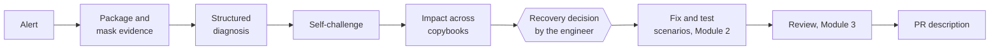

# Module 4: Advanced Prompting and Workflow Redesign
 
 
| Topic                                                     | Minutes |
|-----------------------------------------------------------|---------|
| Package the incident, then force evidence                 | 5       |
| Make it challenge itself, then make it reusable           | 5       |
| Guided practice: diagnose the S0C7                        | 20      |
 
**Total lesson run time:** 30 min
 
## Table of Contents
 
- [Learning Objectives](#learning-objectives)
- [What You'll Need](#what-youll-need)
- [Introduction: 2:10 A.M., step 3](#introduction-210-am-step-3)
- [Package the incident, then force evidence](#package-the-incident-then-force-evidence)
- [Make it challenge itself, then make it reusable](#make-it-challenge-itself-then-make-it-reusable)
- [Guided practice: diagnose the S0C7](#guided-practice-diagnose-the-s0c7)
    - [Step 1, the vague prompt (3 minutes)](#step-1-the-vague-prompt-3-minutes)
    - [Step 2, the structured prompt (6 minutes)](#step-2-the-structured-prompt-6-minutes)
    - [Step 3, make it challenge itself (4 minutes)](#step-3-make-it-challenge-itself-4-minutes)
    - [Step 4, trace the impact (4 minutes)](#step-4-trace-the-impact-4-minutes)
    - [Step 5, save what worked (3 minutes)](#step-5-save-what-worked-3-minutes)
- [Check for Understanding](#check-for-understanding)
- [Summary](#summary)
- [Vocabulary](#vocabulary)
## Learning Objectives
 
- Package incident evidence (job log, abend output, copybook and recent changes) and mask customer data before any of it reaches a prompt.
- Write structured prompts that force evidence, step-by-step reasoning across competing hypotheses, and a fixed output format.
- Ask AI to challenge its own diagnosis, and rule out the most plausible alternative with evidence rather than opinion.
- Compare a vague prompt and a structured prompt on the same incident, and explain why they reach different answers.
- Use AI to trace the impact of bad data across shared copybooks and programs, and know where that trace stops.
- Save your prompts as a reusable playbook, and write a `copilot-instructions.md` file with team conventions and a PII/PCI rule.
## What You'll Need
 
Everything runs in VS Code. You'll investigate from the evidence pack; nothing in this lesson touches a live system.
 
- VS Code with the course COBOL extension, and GitHub Copilot Chat signed in
- The `module-4/` folder from the course pack, open as your workspace:
  - `incident-1/`, the evidence for tonight's abend: `EODINT-joblog.txt`, `CEEDUMP-excerpt.txt`, `INTCALC-listing-excerpt.txt`, `change-calendar.md`, `ACCTUPD-CR-48790.diff` and `ACCTUPD-sysout.txt`
  - `src/`, the programs and copybooks you've met already: `INTCALC.cbl` (as deployed yesterday, with the Module 2 rate change), `FEEASSES.cbl`, `ACCTUPD.cbl` and `ACCTREC.cpy`
  - `incident-2/`, the DB2 incident for the Lab. Leave it closed for now.
- Two empty files, already in the course pack: `incident-playbook.md`, and `.github/copilot-instructions.md`. Leave them empty until Step 5: Copilot adds the instructions file to every request, so filling it early would change what the Step 1 vague prompt shows.
> [!IMPORTANT]
> Job logs and dumps contain customer data: account numbers, balances, sometimes names. The course pack is synthetic, but you'll practise masking it anyway, because on a real incident at 2 a.m. this is the step people skip. Mask before you attach, every time.
 
## Introduction: 2:10 A.M., step 3
 
It's Saturday, 31 October. At 2:10 a.m. your phone goes. The end-of-day interest job, `EODINT`, has abended in step 3 with an **S0C7**.
 
You know this job. Step 3 is `INTCALC`, the program you documented in Module 1 and tested in Module 2. The batch window closes at 5:00 a.m. If `EODINT` hasn't finished by then, the online day starts without last night's interest posted, and every job that depends on the new account master is late.
 
You have four things: the job log, the abend output, the copybook and the change calendar. The calendar shows that yesterday evening, three changes went in. One of them was the rate-precision change to `INTCALC` itself.
 
Every experienced engineer knows what happens next. The program that failed was changed yesterday. The obvious answer is that the change broke it. Back it out and go back to bed.
 
That's the most dangerous moment in the incident: the first plausible answer, reached before the evidence is read. An AI assistant makes that moment *faster*, not safer, unless you prompt it to do the opposite. Ask it a vague question and it gives you the plausible answer, fluently and with confidence.
 
This session teaches the other way to ask. You give it the evidence, make it reason through more than one explanation, demand proof for each claim, and make it argue against itself before you act. Then you save how you asked, so the next person on call starts where you finished.
 
## Package the incident, then force evidence
**Time:** 5 minutes
 
**Context first.** The diagnosis can only be as good as what you give the model. In Module 1 you packaged a program with its copybooks and JCL. An incident needs a different pack.
 
**Figure 01,** the incident evidence pack
 
| Evidence             | What it tells you                                                      | What the model guesses without it                          |
|----------------------|------------------------------------------------------------------------|------------------------------------------------------------|
| Job log              | Which step failed, the abend code, what ran before it                  | Which program, and whether earlier steps were clean        |
| Abend output (`CEEDUMP`) | The failing statement, and the field values at the moment of failure | *Which* field held bad data, and how many records were processed first |
| Compile listing      | Which source line a statement number refers to                         | The line. Statement numbers are not source line numbers    |
| Copybook             | Field positions, `PIC` clauses and formats                             | What "invalid data" in a `COMP-3` field actually looks like |
| Change calendar      | What changed recently, and where                                       | Nothing. It will assume the failing program changed        |
 
**Mask before you attach.** Open the job log and dump, and replace account numbers with a masked form, such as `7100****1733`, using **Edit > Replace** (or `Ctrl+H`). Keep enough of the value to tell records apart. Never paste names, full account numbers or card numbers into a prompt.
 
**Then force evidence.** A structured incident prompt has six parts, and each one closes a gap the model would otherwise fill by guessing.
 
**Figure 02,** anatomy of a structured incident prompt
 
| Part           | What it says                                                                     | What it prevents                                    |
|----------------|----------------------------------------------------------------------------------|-----------------------------------------------------|
| **Context**    | The evidence files, attached with `#file`                                        | Answers from general knowledge                      |
| **Role**       | "You are a mainframe production-support engineer"                                | A generic, beginner-level explanation               |
| **Task**       | "Find the root cause of this abend"                                             | Drifting into fixes before the cause is known       |
| **Reasoning**  | "List at least three hypotheses. For each, give evidence for and against"         | Locking on to the first plausible answer            |
| **Evidence rule** | "Cite the file and line, or the dump field, for every claim"                 | Confident claims nobody can check                   |
| **Output format** | "Root cause, confidence, evidence, ruled out, next action"                   | A wall of prose you have to dig the answer out of   |
 
You'll see both versions of the prompt run against tonight's abend in the guided practice. The difference isn't subtle.
 
> **Discuss:**
>
> Think of your last overnight incident. How long did it take you to collect the evidence in Figure 01, and which piece did you go looking for last?
 
## Make it challenge itself, then make it reusable
**Time:** 5 minutes
 
**Self-challenge.** Once the model has a diagnosis, ask it to attack it. This is the cheapest check in the whole workflow, and the one most people skip.
 
```text
Argue against your own diagnosis. What is the strongest alternative
explanation? What evidence in the pack would prove the alternative,
and is that evidence present? What one thing should I check before I
act on your diagnosis?
```
 
Two things happen. If the diagnosis is weak, the model often abandons it, which is exactly what you want at 2:10 a.m., before you've changed anything. And if it's strong, you get the evidence that rules out the alternative, in a form you can paste straight into the incident record.
 
**Make it reusable.** The prompts that worked tonight shouldn't live only in your chat history. There are two places to keep them.
 
- **A playbook**, `incident-playbook.md`: your tested prompts for each stage of an incident, with blanks for the evidence. The next person on call copies, fills in and runs them.
- **`.github/copilot-instructions.md`**: a file in your workspace that Copilot Chat in VS Code reads and adds to every request automatically. (Check that instruction files are enabled in your Copilot settings.) It holds the rules you'd otherwise repeat in every prompt: the PII/PCI rule, the evidence rule, your output format and your team's coding conventions.
The instructions file changes what "a vague prompt" means. With good instructions in place, even a short question inherits your evidence rule and your data-handling rule.
 
**Workflow redesign.** Put it together and an incident becomes a sequence of steps, each with a prompt and a person who decides.
 
**Figure 03,** incident to release-ready change
 

 
AI speeds up every box. It doesn't make the decision in the hexagon: what to do before 5:00 a.m. is yours.
 
**Knowledge check, why the instructions file?** A colleague asks Copilot, "Why did this job fail?" and attaches an unmasked dump. What would your `copilot-instructions.md` need to say for Copilot to stop and warn them?
 
## Guided practice: diagnose the S0C7
**Time:** 20 minutes
 
Work through five steps with your instructor. Run each prompt in your own Copilot Chat, compare your answer with the room's, then check it against the evidence. By the end you'll have a root cause you can defend, an impact list, and the start of your playbook and instructions file. To paste an answer into your file without Copilot's working log, end each prompt with *"Put your whole answer in a single Markdown code block"* and use the code block's **Copy** icon.
 
Start a **new chat** for Step 1 and another for Step 2, so the vague answer doesn't influence the structured one.
 
**Mask first, before you ask anything.** Copilot can open and read any file in the folder you have open, even in Ask mode and even when you attach only one file. So mask every evidence file now, including tonight's Lab incident. Choose **Edit > Replace** (or Ctrl+H), turn on **Use Regular Expression** (the `.*` button), and use **Replace All** in each file:
 
| File                               | Find                 | Replace with  | Matches          |
|------------------------------------|----------------------|---------------|------------------|
| `incident-1/CEEDUMP-excerpt.txt`   | `7100(\d{4})(\d{4})` | `7100****$2`  | 2                |
| `incident-1/EODINT-joblog.txt`     | `7100(\d{4})(\d{4})` | `7100****$2`  | 8                |
| `incident-2/STMTPREP-joblog.txt`   | `7100(\d{4})(\d{4})` | `7100****$2`  | 4                |
| `incident-2/dba-query.txt`         | `7100(\d{4})(\d{4})` | `7100****$2`  | 4                |
| `incident-2/dba-query.txt`         | `(C00\d)\d{6}`       | `$1******`    | 3 (customer IDs) |
 
Leave `ACCTUPD-CR-48790.diff` as it is: its two 12-digit numbers are the limits of the onboarding account range, not customer accounts. Save each file, and check the Explorer's top line says **MODULE-4**, so `#codebase` searches only this module.
 
### Step 1, the vague prompt (3 minutes)
 
First, the way most people ask at 2 a.m.:
 
```text
#file:INTCALC.cbl
 
INTCALC abended with an S0C7 last night. It was changed yesterday.
What's wrong with it?
```
 
**Expected result.** Expect something like this:
 
> An S0C7 is a data exception, usually caused by invalid data in a numeric field. Since `INTCALC` was changed yesterday to extend `WS-APPLIED-RATE` and the rate fields to three decimal places, the most likely cause is a mismatch between the new layout and the rate file. If `RATETIER.CURRENT` was not updated in the same release, `RI-TIER-RATE-PCT` will contain invalid data. Recommend backing out the change.
 
It's fluent, specific and plausible. It even echoes the release risk you found yourself in Module 2. And it's wrong, as you're about to prove. Notice *why* the model said it: you told it the program changed, and gave it nothing else. It answered the question you implied.
 
Don't act on this answer. Keep it, because you'll compare it in Step 3.
 
**Or it goes looking.** Newer versions of Copilot sometimes open other files in the folder by themselves, even in Ask mode: the dump, the job log, the change calendar. Then the vague prompt can land on the right answer. Open the list of files it read (expand **Used … references**, or read its working log) and ask: *Who chose the evidence? Did it check for other bad records? Did it give a confidence, or a next action you could act on at 2 a.m.?* It won't have. A good answer you can't defend is still a guess, and if you hadn't masked first, it would just have read unmasked customer data.
 
### Step 2, the structured prompt (6 minutes)
 
Check that your evidence files are masked (account numbers show as, for example, `7100****1733`). Then start a new chat:
 
```text
#file:EODINT-joblog.txt #file:CEEDUMP-excerpt.txt
#file:INTCALC-listing-excerpt.txt #file:ACCTREC.cpy
#file:change-calendar.md #file:ACCTUPD-CR-48790.diff #file:ACCTUPD-sysout.txt
 
Treat the current time as Sat 31 Oct 2026 02:10.
 
You are a mainframe production-support engineer. EODINT abended in
STEP030 with an S0C7. Find the root cause.
 
1. From the job log and dump, state the failing statement, the source
   line it maps to, every field the dump shows as invalid, and the
   program's record counters at the time of the abend.
2. List at least three hypotheses for the cause, including each change
   on the change calendar. For each, give the evidence for and against.
3. Reason step by step to the most likely root cause.
 
Cite the file and line, or the dump field, for every claim. If the
evidence does not establish something, write "not established".
 
Return: Root cause | Confidence | Evidence | Ruled out (and why) |
Next action
```
 
**Expected result**
 
**Failing statement.** Statement 142 maps to `WHEN ACCT-BALANCE NOT > ZERO` in `1000-PROCESS-ACCOUNT`. The dump shows `ACCT-BALANCE`, `ACCT-ACCRUED-INT` and `ACCT-LAST-INT-DATE` all holding `X'40'` bytes, which are EBCDIC spaces. Spaces are not valid packed decimal, so the comparison raises a data exception.
 
**Root cause.** Account `7100****1733` reached `INTCALC` with spaces in all its numeric fields. It was created last night by `ACCTUPD`, under change CR-48790, which added new accounts from the digital onboarding feed. The new paragraph moves the 15-byte `NEWACCT-REC` into the 100-byte `ACCT-REC` as a group move. A group move is an alphanumeric move, so the remaining 85 bytes are padded with spaces. Nothing initialises the numeric fields.
 
**Confidence.** High.
 
**Evidence.** The dump fields; the record's footprint, with `ACCT-TYPE` and `ACCT-STATUS` filled in (`'SV'`, `'A'`) and every byte from 16 on holding spaces, exactly what a 15-byte group move into a 100-byte record leaves behind; `ACCTUPD-sysout.txt` reports 3 new accounts added; and `WS-READ-CNT` shows this was the 4,183rd record, so 4,182 accounts were processed successfully before it.
 
The account number itself can't help here. Unmasked, it sits in the onboarding range named in the CR-48790 diff, but your mask hides those digits, so a careful model will say that link is "not established". That's the evidence rule working, and a fair trade: masking protects the data, and can hide a clue. The footprint makes the same case without the number.
 
**Ruled out.**
 
- **CR-48812, the rate change.** If the rate file and layout were mismatched, the failure would be in the rate fields, in `2000-ACCRUE-INTEREST`, on the *first* active account. Instead, 4,182 accounts were processed and 3,906 of them accrued interest with the new rate code (`WS-ACCRUED-CNT`), and the failing field is the account balance.
- **CR-48801, the `STMTGEN` footer.** `STMTGEN` doesn't run in `EODINT`.
**Next action.** Confirm all three onboarding records hold spaces in their numeric fields, then decide on recovery.
 
**Check it against the evidence.** Open the dump and find `ACCT-BALANCE` yourself. Open the diff and find the `MOVE NEWACCT-REC TO ACCT-REC`. Then look at `WS-READ-CNT`. That one number, 4,183, is what separates the two answers: thousands of accounts had already run through the new rate code without a problem. It's the kind of evidence a person rarely looks for at 2 a.m., and a structured prompt surfaces automatically.
 
### Step 3, make it challenge itself (4 minutes)
 
In the same chat as Step 2:
 
```text
Argue against your own diagnosis. What is the strongest alternative
explanation? What evidence in the pack would prove it, and is that
evidence present? Then compare your diagnosis with this one from
another engineer, and say which is better supported and why:
 
"Since INTCALC was changed yesterday to extend WS-APPLIED-RATE and the
rate fields, the most likely cause is a mismatch between the new layout
and the rate file. Recommend backing out the change."
 
Finally, what one thing should I check before acting?
```
 
Paste your own Step 1 answer in place of the quoted one if it differs.
 
**Expected result.** The model should name the rate-file mismatch as the strongest alternative, then show that the evidence rejects it: the failing statement is 142, not in `2000-ACCRUE-INTEREST`; the invalid field is `ACCT-BALANCE`, not a rate field; and 4,182 records were processed before the failure. It should judge the Step 2 diagnosis better supported, because it explains *which* field, *which* record and *why now*.
 
The one thing to check before acting: **are there other bad records beyond this one?** `ACCTUPD` added three. If you fix only the record in the dump and restart, the job will abend again on the next one, at about 3:30 a.m., with less window left.
 
**Check it against the evidence.** Now compare Step 1 with Steps 2 and 3, side by side. Backing out CR-48812 would have cost you a change, a rerun, and a second S0C7 an hour later, with the real cause still in the file. That's what the vague prompt was worth.
 
**The recovery decision is yours.** The usual safe choice at this hour is a data fix, not a code fix. With approval, correct the three onboarding records so their numeric fields hold zeros, then restart `EODINT` from `STEP020`. Code changes to `ACCTUPD`, and perhaps to `INTCALC`, go through a normal change, tested the Module 2 way and reviewed the Module 3 way. AI can draft the data-fix request for you. Whether to apply it is not its decision.
 
### Step 4, trace the impact (4 minutes)
 
Tonight's abend is in `INTCALC`, but the bad records are in the account master, and the account master is read by more than one program.
 
```text
#codebase #file:ACCTREC.cpy #file:change-calendar.md
 
Three records on the account master have spaces in ACCT-BALANCE,
ACCT-ACCRUED-INT, ACCT-LAST-INT-DATE and ACCT-WITHDRAWALS-MTD.
Which other programs use this copybook? For each program in this
workspace that copies ACCTREC, say whether it would read these fields
for an active account, in which paragraph, and when it next runs.
List only what you find in the code and the change calendar. Separately, list programs that
the copybook header names but that are not in this workspace.
```
 
**Expected result**
 
| Program    | Uses the bad fields?                                                     | Where                     | Next run, and risk                                  |
|------------|--------------------------------------------------------------------------|---------------------------|-----------------------------------------------------|
| `INTCALC`  | Yes: compares `ACCT-BALANCE`                                             | `1000-PROCESS-ACCOUNT`    | Tonight. Already failed                             |
| `FEEASSES` | Yes: compares `ACCT-BALANCE` with the waiver balance, reads withdrawals | `2000-CALC-FEE`           | **Tonight's month-end fee run, `FEEMTH`**. It will abend the same way unless the data is fixed first |
| `ACCTUPD`  | Writes the bad records; whether it reads them back is not established    | `2400-ADD-NEW-ACCOUNTS`   | Every night: it will create more bad records from tomorrow's onboarding feed |
| `CUSTLINK` | Yes: moves `ACCT-BALANCE` into the statement extract                     | `3000-WRITE-EXTRACT`      | `STMTPREP`, Sun 03:45. Whether it abends or passes the spaces on to statements is not established |
| `STMTGEN`  | Named in the `ACCTREC` header, but not in this workspace                 | Not in workspace          | Unknown. Confirm with a repository search           |
 
**Check it against the evidence.** The `FEEASSES` row is the one that turns tonight's incident into tomorrow's. `FEEMTH` runs the month-end fees with `PARM` date `2026-10-31`. If you fix only what `EODINT` needs and move on, the on-call engineer tomorrow night gets the same S0C7 in a different program.
 
And the `ACCTUPD` row is why a data fix alone isn't enough. It needs a code fix, probably an `INITIALIZE ACCT-REC` before the fields are moved, or tomorrow's feed brings new bad records.
 
As in Module 1, `#codebase` sees only your workspace, and the copybook header is a claim. `STMTGEN` goes on the list as "unconfirmed".
 
### Step 5, save what worked (3 minutes)
 
Start the two files you'll finish in the Lab.
 
**`incident-playbook.md`.** Paste in the three prompts that worked: the structured diagnosis from Step 2, the self-challenge from Step 3 and the impact trace from Step 4. Replace the incident-specific details with placeholders, such as `<incident time>`, `<job>`, `<step>`, `<abend code>` and `<evidence files>`. Keep the line that sets the time: without it, Copilot uses today's real date, and an incident from last week looks like it has already missed its deadline. Add a first line before them: **"Mask account numbers and customer data before attaching anything."**
 
**`.github/copilot-instructions.md`.** Start with this, then make it yours:
 
```markdown
# Copilot instructions: savings batch team (COBOL, z/OS)
 
## Customer data (PII/PCI)
- Never include customer names, full account numbers, card numbers or
  addresses in a reply. Show account numbers masked, e.g. 7100****1733.
- If attached evidence contains unmasked customer data, say so before
  answering, and do not repeat it.
 
## Evidence
- Cite the file and line number, or the dump field, for every factual claim.
- If the evidence doesn't establish something, write "not established"
  and say what would establish it.
 
## Diagnosis
- List hypotheses before concluding, with evidence for and against each.
- Do not propose code changes until the root cause is supported by evidence.
- Answer in this format: Root cause | Confidence | Evidence | Ruled out | Next action.
 
## Our code
- Enterprise COBOL batch. Paragraph names follow NNNN-VERB-NOUN.
- Every FILE STATUS and SQLCODE must be checked.
- Numeric fields read from files must pass a NUMERIC class test before use.
- Arithmetic must use ROUNDED or state that truncation is intended.
 
## Recovery
- Recovery is the engineer's decision. Propose the least-change option
  first (a data fix and restart), separately from code fixes.
- Never propose restoring an earlier generation of a file without
  saying what it would discard.
```
 
**Check it.** Open a new chat and ask the vague Step 1 question again. With the instructions file in place, the answer should now list hypotheses, cite evidence, and say "not established" where it has only the program to go on. That's the point of the file: your standards apply even when someone asks a lazy question at 2 a.m.
 
> **Discuss:**
>
> Which part of tonight's workflow took longest before AI, and which part would you still insist a person does? Where in Figure 03 would you put your own team's biggest delay?
 
## Check for Understanding
 
Before moving into the Lab, work through these, out loud or on paper.
 
- The vague prompt blamed the rate change. Name the single piece of evidence that rules it out, and explain why.
- Why did masking come before attaching the dump, and what does your `copilot-instructions.md` do if someone forgets?
- A group `MOVE` from a 15-byte record to a 100-byte record left spaces in packed fields. Why didn't `ACCTUPD` abend when it wrote them, while `INTCALC` did when it read them?
- You fix the one record in the dump and restart. What happens, and which step in the guided practice would have prevented it?
- Name two things AI did faster in this incident, and one decision it should never make for you.
## Summary
 
- The first plausible answer is the dangerous one. A vague prompt gives it to you faster, with more confidence.
- Package the incident: job log, abend output, listing, copybook and change calendar. Mask customer data before you attach anything.
- Structured prompts close the gaps a model fills by guessing: context, role, task, competing hypotheses, an evidence rule and a fixed output format.
- Ask the model to argue against itself. It's the cheapest check you have, and it tells you what to verify before you act.
- Trace impact across shared copybooks. Bad data in a shared file is tomorrow's incident in a different program.
- Recovery decisions belong to the engineer. AI drafts; you decide.
- Save what worked. A playbook gives the next person your prompts; `copilot-instructions.md` gives every prompt your standards.
In the Lab, you open `incident-2/`, a DB2 `SQLCODE -811` from a Jira-style ticket. You take it from root cause through impact, a proposed fix, test scenarios and a PR description, using and extending your playbook. Then you record how long each stage would have taken you before this course, and how long it took today.
 
## Vocabulary
 
- **S0C7 (data exception)**, the abend raised when the processor finds invalid data in a packed or zoned decimal field during arithmetic or comparison. Spaces in a `COMP-3` field are the classic cause.
- **`CEEDUMP`**, the Language Environment dump written when a program abends. It shows the failing statement, the call traceback and, for programs compiled with the right options, field values at the time of failure.
- **Compile listing**, the compiler's output for a program, mapping statement numbers in the dump to lines of source.
- **Group `MOVE`**, a `MOVE` between group items. It is treated as alphanumeric: bytes are copied left to right and the rest of the receiving field is padded with spaces, whatever the subordinate fields' `PIC` clauses say.
- **`INITIALIZE`**, a COBOL statement that sets alphanumeric fields in a group to spaces and numeric fields to zero. The usual fix for a record built by a group move.
- **`NUMERIC` class test**, `IF field NUMERIC`, which checks a field holds valid numeric data before it's used.
- **Incident evidence pack**, the set of artifacts an investigation needs: job log, abend output, listing, copybook and recent changes, masked before sharing.
- **Structured prompt**, a prompt with explicit context, role, task, reasoning instructions, evidence rule and output format.
- **Self-challenge**, asking a model to argue against its own conclusion and name the evidence that would prove an alternative.
- **Recency bias**, assuming the most recent change caused a failure because it is recent, not because the evidence points to it.
- **Prompt playbook**, a file of tested, reusable prompts for each stage of a recurring task, with placeholders for the specifics.
- **`copilot-instructions.md`**, a file in the workspace's `.github` folder whose contents Copilot Chat adds to every request, used for team conventions and rules.
- **Data fix**, correcting bad records in a dataset, with approval, so a failed job can be restarted without a code change.

